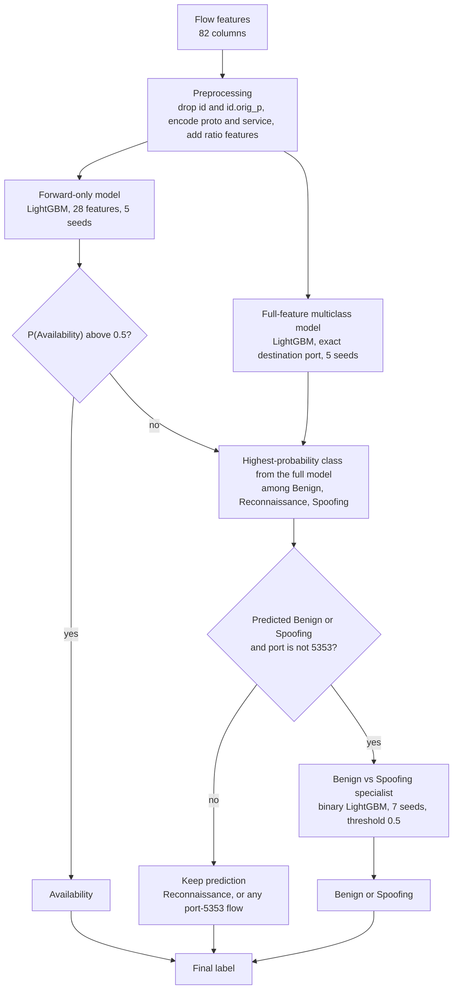

<div align="center">

# Network Intrusion Detection Using Machine Learning

**A multiclass traffic-classification pipeline exploring distribution shift, class imbalance, and profile-aware generalization.**


</div>

> Built for the **GDG on Campus AI/ML Volunteer Recruitment Challenge** (individual, 48 hours, Kaggle).
> This is a competition model for a fixed dataset. It is **not** a production intrusion-detection or prevention system.

---

## Contents

[Overview](#overview) · [Results](#results) · [Dataset](#dataset) · [Preprocessing](#preprocessing-and-features) · [Architecture](#model-architecture) · [Distribution shift](#distribution-shift-findings) · [Validation](#validation-strategy) · [Experiments](#experiments-and-decisions) · [Run it](#running-the-project) · [Limitations](#limitations) · [Takeaways](#key-takeaways)

---

## Overview

Network intrusion detectors that score well on familiar traffic often degrade on traffic from behaviours they have not seen. In this challenge the evaluation data deliberately contains traffic **profiles that are separated from the training data**, so high training accuracy or a random-split validation score says little about leaderboard performance.

The task: classify each extracted network flow (82 numeric and categorical features) into one of four classes.

| Class | Description |
|---|---|
| Benign | Normal network activity |
| Availability | Attacks targeting service availability |
| Reconnaissance | Scanning and information-gathering activity |
| Spoofing | Traffic involving identity or address impersonation |

**Why it is hard**

- **Severe imbalance:** 94.5% of the training rows are one class.
- **Metric:** macro F1 gives all four classes equal weight, so the 735 Reconnaissance rows matter as much as the 80,072 Availability rows.
- **Distribution shift:** train and test are almost perfectly separable (adversarial-validation AUC of 1.0, see [below](#distribution-shift-findings)).
- **Misleading validation:** a random split would score far higher than the model deserves on new profiles.

$$\text{Macro F1} = \frac{F1_{\text{Benign}} + F1_{\text{Availability}} + F1_{\text{Reconnaissance}} + F1_{\text{Spoofing}}}{4}$$

---

## Results

<div align="center">

### Best public leaderboard score: **0.84616** Macro F1

</div>

| Metric | Result |
|---|---:|
| Best **public** Macro F1 | **0.84616** |
| Previous best (public) | 0.84585 |
| Absolute improvement | +0.00031 |
| Prediction classes | 4 |

**Read this before drawing conclusions**

- All figures above are **public leaderboard** scores. The public set is roughly 40% of the test data; the remaining 60% decides the **private** ranking. The public score does not guarantee private performance, and the private score is not known.
- The two partitions contain different reserved traffic profiles, so the pipeline was selected on profile-aware validation, not on public score alone.
- No ranking, percentile or award is claimed.

### Submission history (public Macro F1)

| Submission | What it was | Public Macro F1 |
|---|---|---:|
| Original best | Exact-port LightGBM + forward-only Availability model | 0.84585 |
| Common-port variant | Bucketed/common ports; 414 rows differ from the original (almost all port 5353) | 0.84581 |
| Controlled probe A | Single-packet port-5353 flows relabelled Benign (about 1,930 rows) | 0.84546 |
| Controlled probe B | Port-53 flows predicted Benign relabelled Spoofing (3,640 rows) | 0.65348 |
| **Specialist-only final** | Original best + Benign/Spoofing specialist, **94 rows changed**, port 5353 untouched | **0.84616** |

The two "probes" were deliberate experiments: each changes one group of rows in an otherwise identical file, so the score change shows how much of that group lies in the public split. Probe B's large drop showed the original port-53 Benign calls were largely correct and heavily represented in the public split. Probe A's tiny change showed that port-5353 flows are almost entirely absent from the public split, so that group's labels could not be checked against the leaderboard.

### Validation of the final change (not Kaggle scores)

Paired comparison on identical held-out folds, 3 seeds each: the original pipeline versus the same pipeline plus the specialist (port 5353 excluded).

| Scheme | Original Macro F1 | Specialist-only Macro F1 | Difference |
|---|---:|---:|---:|
| S1: cluster hold-out | 0.641 | 0.653 | +0.012 |
| S2: unseen destination ports | 0.718 | 0.805 | +0.088 |
| S3: unseen traffic signatures | 0.791 | 0.792 | +0.001 |

The difference was positive in **9 of 9** paired scheme/seed comparisons. The gain is concentrated: about 4 of 12 folds improve by more than 0.01, the others are within ±0.005, and the worst single seed-fold change is −0.008.

These are validation numbers on held-out groups of the training data. They are **not** leaderboard scores, and they did not transfer proportionally: the final file changes only 94 of 33,161 test rows, so a small leaderboard movement is the expected size of effect.

---

## Dataset

Source: the competition's own files (not redistributed here; see [Running the project](#running-the-project)).

| File | Rows | Columns |
|---|---:|---|
| `train.csv` | 84,713 | `id` + 82 features + `Target` |
| `test.csv` | 33,161 | `id` + 82 features |
| `sample_submission.csv` | 33,161 | `id`, `Target` |

- **Features:** 82 per-flow features: 80 numeric (ports, packet and byte counts, header sizes, TCP flag counts, inter-arrival-time statistics, payload statistics, window sizes, bulk and idle/active statistics) and 2 categorical (`proto`, `service`).
- **Data quality:** no missing values in train or test; no duplicate feature rows in train; one constant feature (`fwd_URG_flag_count`).
- **Protocol mix differs between sets:** train is 97.6% TCP, test is 68.9% TCP and 31.1% UDP.

| Class | Train rows | Share |
|---|---:|---:|
| Availability | 80,072 | 94.52% |
| Spoofing | 2,323 | 2.74% |
| Benign | 1,583 | 1.87% |
| Reconnaissance | 735 | 0.87% |

Accuracy is uninformative here: always predicting Availability would be 94.5% accurate and have a macro F1 near 0.25.

---

## Preprocessing and features

All steps are in [`notebooks/01_pipeline_and_experiments.ipynb`](notebooks/01_pipeline_and_experiments.ipynb).

- **Dropped:** `id` (a hash) and `id.orig_p` (the source port, an OS-chosen ephemeral value).
- **Encoding:** `proto` mapped to integers (tcp/udp/icmp); `service` mapped to an integer code, with unseen values (e.g. `radius`) assigned to an "other" code.
- **Engineered features:** `pk_ratio` (forward/backward packet ratio), `bytes_per_pkt`, `syn_ack` (SYN-to-ACK flag ratio), `dur_log` (log flow duration). Infinities from divisions become NaN, which LightGBM handles natively.
- **Port handling:** the best model uses the exact destination port. A "common-port" variant keeps the exact port only for a short list of well-known ports and adds a bucket (well-known / registered / ephemeral); this variant is used for the specialist.
- **Missing values / outliers:** none to impute; no explicit outlier clipping (tree models). Constant features were not removed explicitly.
- **Model inputs:** 85 columns for the main model, 28 forward-direction columns for the Availability model, 86 for the specialist.

---

## Model architecture



The Availability decision comes **only** from the forward-only model; the full model's Availability probability is ignored.

**Shared training setup**

- LightGBM: 300 trees, learning rate 0.05, 15 leaves, minimum 20 samples per leaf, row subsampling 0.8, column sampling 0.6.
- Class imbalance: Availability is randomly capped at 8,000 rows per seed (6,000 inside validation folds); all other rows are kept; samples are weighted by inverse class frequency. Predicted probabilities are averaged over seeds.

**1. Full-feature multiclass model** predicts all four classes, but only its Benign / Reconnaissance / Spoofing ranking is used in the final pipeline.

**2. Forward-only Availability model** uses only features available from the sender's side (packet counts, payload sizes, window sizes, inter-arrival times, header sizes, destination port, protocol, service) and ignores everything that depends on a reply. It exists because a model trained on all features first labelled most test port-21 flows as Reconnaissance: it had learned that a reply-and-reset pattern signals Availability, while the test flows carried the same tool fingerprint (120-byte payload, TCP window 64) but no recorded reply. See [distribution shift](#distribution-shift-findings).

**3. Benign/Spoofing specialist** is a binary LightGBM trained only on Benign and Spoofing rows, classes balanced 50/50, shallower trees (7 leaves, minimum 40 samples per leaf), common-port features, 7 seeds averaged, threshold 0.5 (deliberately not tuned). It is applied **only** to rows the main pipeline already labels Benign or Spoofing, and never to port 5353, so Availability and Reconnaissance predictions are untouched. A narrow, validated change was chosen over wider changes that could not be validated. It does not solve the four-class problem on its own.

---

## Distribution shift findings

**Adversarial validation:** a classifier trained to tell train rows from test rows reached AUC ≈ 1.0, so the two sets are very different and a random split would overstate generalization.

**Port 21 and a learned shortcut**

- In train, port 21 is 99.7% Availability, and Availability flows almost always include a reply packet (only 0.12% have none).
- In test, 10,396 flows go to port 21 and **88.1% have no reply packet**. They share the training flood's payload size and window size.
- Masking all reply-dependent features on held-out validation rows dropped the full model's Availability recall from 0.995 to **0.000**, while the forward-only model stayed at **0.995**.
- Conclusion supported by evidence: the full model leaned on reply information; the forward-only model does not.

**Port 5353 and an unsupported change**

- About 2,000 test flows are single UDP packets to port 5353, while train has only 27 Benign/Spoofing examples on that port and no comparable single-packet flows.
- An alternative (the common-port variant) relabelled about 400 of them from Reconnaissance to Spoofing. Neither the training data nor the public leaderboard can confirm which label is right: the probe above indicates these flows lie almost entirely in the private split.
- The final submission therefore **kept the original port-5353 predictions** instead of acting on an assumption it could not check.

**Signature-level agreement check:** for test flows whose exact traffic signature appears at least 5 times in train with at least 90% one label (about 10,000 to 12,000 flows), the pipeline agreed with train on all but 5 to 6. Remaining uncertainty lies in groups with no training analogue.

---

## Validation strategy

A random stratified split puts near-identical flows on both sides, so it rewards memorizing traffic profiles. Three group-aware schemes were used instead, with **identical folds for every compared model**:

| Scheme | Held out | Purpose |
|---|---|---|
| **S1: cluster** | One KMeans cluster (4 per class, on log-scaled non-port features) per fold | Unseen behaviours |
| **S2: unseen port** | Whole destination ports for non-Availability classes (hashed into 4 folds); Availability uses S1 clusters | Ports never seen in training |
| **S3: unseen signature** | Whole traffic signatures (protocol, forward payload total, initial window, forward packet count) | New tool fingerprints |

Practices followed: 3 random seeds per comparison; per-fold as well as pooled results; per-class F1 and confusion matrices; and paired differences between models on the same folds.

**Known weaknesses of this validation**

- It is a proxy built from the training data and cannot reproduce the organizers' hidden profile split.
- Reconnaissance has only 735 rows, so its F1 swings widely between seeds (the same configuration ranged from 0.57 to 0.66 macro F1).
- Two signatures hold 355 of the 735 Reconnaissance rows, and one of them (137 flows) is identical to 93 Availability flows on the available features, so some Reconnaissance error is not fixable.
- The specialist's probabilities are overconfident under shift and it under-predicts Spoofing in held-out folds (measured with the common-port base).

Training metrics, validation metrics and leaderboard scores are reported separately throughout this README and are not comparable to one another.

---

## Experiments and decisions

| Experiment | Approach | Result |
|---|---|---|
| Baseline | LightGBM, balanced weights, Availability downsampled | Starting point |
| Port feature sets | Exact vs bucketed vs common ports (cluster hold-out, 3 seeds) | 0.631 / 0.628 / **0.664**; common ports most stable, but the exact-port model was kept as the base since it was the proven public submission |
| Forward-only Availability model | Reply-independent features | Fixed the port-21 shortcut; Availability recall 0.995 under reply masking |
| Stronger regularization | Shallower trees, larger leaves, higher L2 | Rejected: Reconnaissance F1 fell to 0.03 in a single run |
| ExtraTrees and blend | Second model family | Rejected: 0.462 alone; LightGBM + ExtraTrees 0.657 vs LightGBM 0.664 |
| Importance weighting | Weight train rows by similarity to test | Rejected: 0.655 vs 0.664; weights degenerate because the sets are almost perfectly separable |
| Hierarchical classification | 3-class model on non-Availability rows | Rejected: cluster / port / signature macro F1 0.622 / 0.773 / 0.803 vs 0.693 / 0.732 / 0.807 for the pipeline; Reconnaissance F1 collapsed in S1 (0.27 vs 0.52) |
| Self-training | Pseudo-labels on confident test rows | Not submitted: changes only ~330 rows and cannot be validated |
| **Benign/Spoofing specialist** | Binary LightGBM on Benign and Spoofing rows | **Adopted** (positive in 9 of 9 paired comparisons; small effect) |
| Port-5353 relabelling | Reconnaissance to Spoofing for single-packet mDNS flows | **Rejected** for the final file: no evidence either way |

Hierarchical, ExtraTrees and importance-weighting numbers use the common-port base. Full results table: [`results/group_validation_hier_experiments.csv`](results/group_validation_hier_experiments.csv) (common-port base; includes the reply-masking test).

---

## Repository structure

```text
.
├── README.md
├── requirements.txt
├── .gitignore
├── notebooks/
│   ├── 01_pipeline_and_experiments.ipynb       # EDA, shift analysis, validation, final pipeline, probes
│   └── 02_specialist_only_candidate.ipynb      # specialist-only final variant + paired validation
└── results/
    └── group_validation_hier_experiments.csv   # grouped-validation comparison table
```

Competition data and submission files are intentionally **not** in the repository.

<details>
<summary>Suggested future structure (not yet implemented)</summary>

```text
src/            preprocessing.py, train.py, predict.py, evaluation.py
data/           (git-ignored) train.csv, test.csv, sample_submission.csv
submissions/    (git-ignored)
```

</details>

---

## Running the project

The project is **notebook-based**; there are no standalone scripts.

1. Clone the repository and enter it.
   ```bash
   git clone https://github.com/<your-username>/<your-repo>.git
   cd <your-repo>
   ```
2. Create an environment and install dependencies.
   ```bash
   python -m venv .venv
   source .venv/bin/activate        # Linux/macOS
   .venv\Scripts\activate           # Windows
   pip install -r requirements.txt
   ```
3. Download `train.csv`, `test.csv` and `sample_submission.csv` from the competition page and place them in a `data/` folder (git-ignored). The notebooks search the Kaggle input folder and the working directory, and print the folder they used.
4. Open `notebooks/02_specialist_only_candidate.ipynb` and run all cells (about 5 minutes on 2 CPU cores). It reproduces the original pipeline, applies the specialist, runs the checks and writes a submission CSV in the format `id,Target`.
5. The notebook's checks confirm 33,161 rows, no missing or duplicate IDs, only valid labels, IDs in `sample_submission.csv` order, and that Availability, Reconnaissance and port-5353 predictions are unchanged.

On Kaggle: attach the competition data to a new notebook and run the same cells.

---

## Limitations

- **Public ≠ private.** The reported score covers about 40% of the test data; the final ranking uses the other 60% with different traffic profiles.
- **Validation is a proxy** and cannot confirm performance on the hidden profiles.
- **Unvalidated groups remain:** port-21 flows without replies, window-1024 SYN probes and port-5353 flows have no close training analogue; their labels rest on the training signatures that are most similar.
- **Class overlap:** some Reconnaissance and Availability flows are indistinguishable on the provided features.
- **Calibration:** the specialist's probabilities are overconfident under shift.
- **Test class proportions are unknown;** none are assumed.
- **Scope:** results are specific to this dataset and setup. This is a competition model, not a production IDS, and says nothing about real-world detection rates.

Development used AI-assisted tools, which the competition rules permit.

---

## Key takeaways

1. High accuracy says almost nothing about minority-class performance.
2. Macro F1 changes modelling priorities: every class counts equally.
3. Random validation hides distribution shift; group-aware schemes show it.
4. Models take shortcuts (here, relying on reply packets); inspecting predictions, not only scores, exposed one.
5. Specialist models can sharpen a single class boundary without disturbing the rest.
6. A small, evidence-backed change is preferable to a large speculative one.
7. Leaderboard submissions can serve as controlled experiments (change one group, read the score).
8. The public score is not an estimate of the private score.

---

<sub>Author: &lt;your name&gt; · Competition: &lt;link to Kaggle competition page&gt; · License: &lt;choose a license&gt;</sub>
